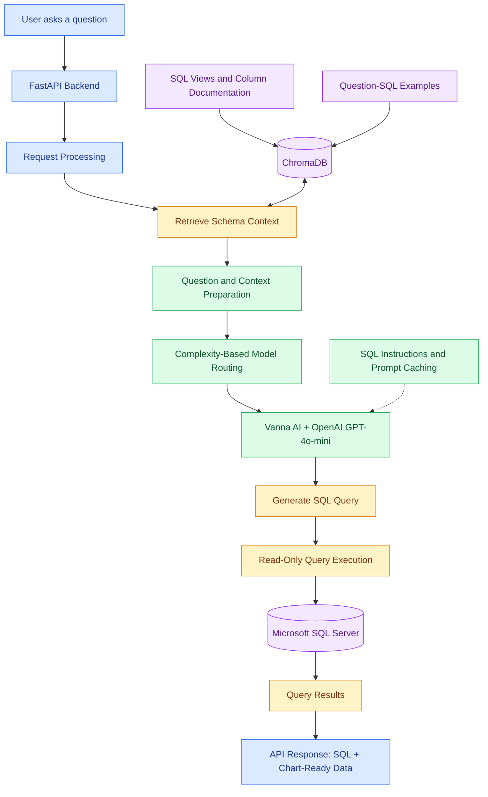

# NLP-Based SQL Chatbot

A natural-language-to-SQL chatbot that enables users to ask questions about structured data in plain English and receive generated SQL queries and chart-ready results.

Built using **Python, Vanna AI, FastAPI, OpenAI GPT-4o-mini, Microsoft SQL Server, and ChromaDB**, the project combines LLM-powered SQL generation with database schema context, reusable question-SQL examples, and model routing.

## Overview

Traditional database querying often requires users to understand SQL syntax and database schemas. This project simplifies database access by translating natural-language questions into SQL queries aligned with the database structure and business requirements.

The application uses curated SQL views and documentation to provide relevant database context to the SQL-generation workflow. It also stores schema-related information and question-SQL examples in ChromaDB to support future requests.

## Key Features

- **Natural Language to SQL:** Converts user questions into SQL queries using Vanna AI and OpenAI GPT-4o-mini.
- **Schema-Aware SQL Generation:** Uses custom SQL views and documented view and column definitions to improve query relevance.
- **SQL Server Compatibility:** Applies SQL-generation instructions aligned with Microsoft SQL Server syntax.
- **Context Retrieval:** Uses ChromaDB to store and retrieve schema documentation and question-SQL examples.
- **Model Routing:** Routes requests to different model configurations according to question complexity.
- **Prompt Caching:** Uses prefix-based prompt caching to reduce repeated prompt-processing overhead where supported.
- **Database Integration:** Connects to Microsoft SQL Server to execute generated read-only queries.
- **Chart-Ready Results:** Returns query results in a format that can support data visualization.
- **REST API:** Uses FastAPI to expose the chatbot's functionality.

## System Architecture

## End-to-End Workflow

### 1. Natural-Language Input

A user submits a business question through the chatbot interface or API.

### 2. Request Processing

FastAPI receives the request and initiates the SQL-generation workflow.

### 3. Retrieve Database Context

ChromaDB stores and retrieves relevant schema documentation and question-SQL examples. Custom SQL views and documented column definitions provide additional context about the underlying data.

### 4. Prepare the Prompt

The retrieved context and SQL-generation instructions are assembled to guide query generation using Microsoft SQL Server syntax.

### 5. Route the Request

The application selects a model configuration based on the complexity of the question, helping balance response quality and processing cost.

### 6. Generate SQL

Vanna AI and OpenAI GPT-4o-mini generate a SQL query based on the question, retrieved context, and database-specific instructions.

### 7. Execute the Query

The backend executes the generated read-only query against Microsoft SQL Server.

### 8. Return Results

The API returns the generated SQL alongside query results that can be used to create visualizations.

## Technology Stack

| Category | Technologies |
|---|---|
| Programming Language | Python |
| Backend Framework | FastAPI |
| Text-to-SQL Framework | Vanna AI |
| Language Model | OpenAI GPT-4o-mini |
| Context Storage and Retrieval | ChromaDB |
| Database | Microsoft SQL Server |
| Query Language | SQL / T-SQL |
| Prompt Optimization | Prefix-Based Prompt Caching |
| Orchestration | Model Routing and SQL-Generation Workflows |

## Database Context Strategy

### Custom SQL Views

Custom SQL views provide structured access to relevant business data and help simplify the database context presented to the SQL-generation workflow.

### View and Column Documentation

Documentation describes the purpose of individual views and columns, helping the model distinguish fields and understand business terminology.

### ChromaDB Knowledge Store

ChromaDB stores:

- SQL view and schema documentation.
- Relevant column descriptions.
- Saved question-SQL pairs.
- Other SQL-generation context used by the application.

This information can be retrieved to support subsequent natural-language questions.

## SQL Safety

The application is designed around read-only SQL queries.

A production deployment should also enforce read-only database credentials, validate generated SQL before execution, apply query timeouts and resource limits, and restrict access to approved views or tables. These safeguards should be listed as implemented features only if they are present in the actual application.

## Model Routing and Prompt Caching

### Model Routing

The application routes questions to different model configurations according to their complexity. This approach can help allocate more capable or more expensive configurations to questions that need them.

### Prefix-Based Prompt Caching

The application uses prefix-based prompt caching to reduce repeated prompt-processing overhead where supported by the selected model and API configuration.

## API Output

The backend returns the generated SQL and query results. The results can be prepared for visualization in a consuming frontend.

A representative response structure might include:

- Generated SQL query.
- Query result records.
- Column names or metadata.
- Chart-ready data.

The exact response schema depends on the implemented API.

## Use Cases

- Business data exploration through natural-language questions.
- Querying structured data without manually writing SQL.
- Generating SQL for documented database views.
- Retrieving tabular results for reporting and visualization.
- Making database information more accessible to non-SQL users.

## Future Improvements

- Add a documented API setup and usage guide.
- Build a representative natural-language-to-SQL evaluation dataset.
- Measure SQL execution accuracy and result correctness.
- Add SQL validation and query-cost controls if not already implemented.
- Improve logging, observability, and error handling.
- Add example questions and sanitized output screenshots.
- Provide a reproducible local development setup.

## Security Notes

- Never publish database credentials, API keys, or private connection strings.
- Do not include confidential schemas, production records, or internal company code.
- Use synthetic or sanitized examples in public documentation.
- Ensure production database access is restricted and read-only where appropriate.

## Project Summary

This project demonstrates how **LLMs, natural-language-to-SQL generation, database context retrieval, model routing, and backend API development** can be combined to make structured data easier to query through conversational interfaces.
